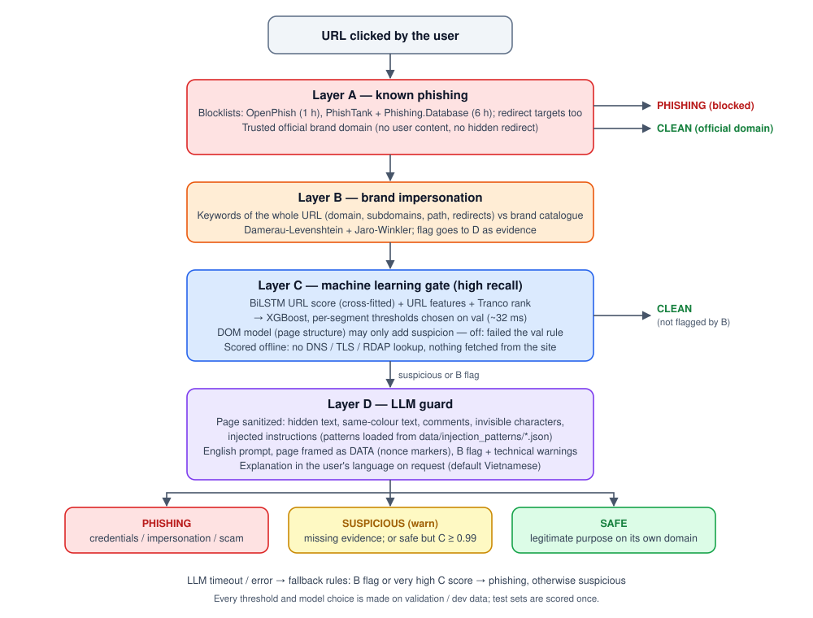
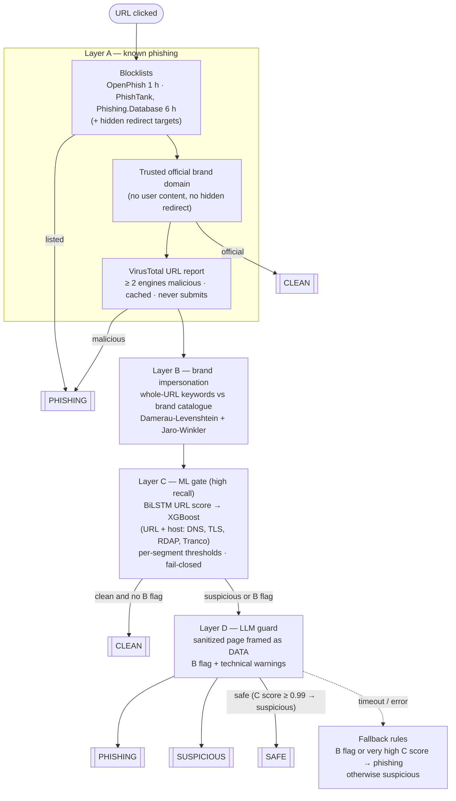

# AI phishing website detection

A four-layer system that decides, for a URL a user clicks, whether the website is **phishing**,
**suspicious** (warn the user) or **clean / safe**. Cheap, exact checks run first; the costly
LLM reads the page only when the earlier layers cannot clear the URL.



## System architecture



| Layer | What it does | Code |
|---|---|---|
| **A** | Known phishing URLs / hosts / campaign domains from public feeds (also behind redirect parameters); VirusTotal report; official domains of verified brands end as clean | `src/blocklist/`, `src/pipeline.py` |
| **B** | Brand impersonation: keywords from the domain, subdomains, path and redirect targets compared with the brand catalogue (`dataset/brands/`) | `src/typosquatting/` |
| **C** | Two cross-fitted **BiLSTM** URL models give a phishing score; **XGBoost** combines it with hand-crafted URL features and host features (lexical branch, or host branch when the host resolves). Thresholds per segment keep almost every phishing URL away from "clean"; a failed host lookup gives "suspicious". The pair was chosen on validation data among 5 deep models × 3 classifiers. A DOM model (page structure) is trained and measured; it may only add suspicion and is off in production because it did not meet the validation rule | `src/url_classifier/`, `src/layer_c_selection.py` |
| **D** | LLM (default `gpt-6-luna`; `claude-haiku-5-5` measured) reads the sanitized page and returns phishing / suspicious / safe; explanation on request in the user's language | `src/llm/` |

## Architectural principles

- **One language in the code base.** Code, comments and LLM prompts are English. Only data is
  multilingual (Vietnamese page content, test pages, keyword lists).
- **Language data is externalized.** Every language-specific list — prompt-injection regexes,
  quoted authorities and their domains, verdict words, negations, bait words — lives in
  `data/injection_patterns/<lang>.json` and is merged by `html_sanitize.PatternLoader`.
  Adding a language is adding a file. Brand names live in `dataset/brands/`.
- **One prompt, dynamic output language.** The LLM prompt is English; the explanation language is
  a user setting (`lang`, default `vi`) and the verdict keyword stays English.
- **Page content is untrusted data.** The sanitizer removes hidden text, same-colour text,
  comments, invisible characters and injected instructions; the page is framed by random nonce
  markers; a page that hides instructions is reported to the model as strong evidence.
- **Fail closed.** A failed host lookup, a missing LLM verdict or an LLM "safe" on a URL the
  classifier is nearly sure of never become "clean". Attacker-controlled page structure (DOM)
  can only add suspicion.
- **No leakage, no cherry-picking.** Splits are by site; the Vietnamese test set shares no
  registrable domain with any training or evaluation file; every choice is made on validation /
  dev data; test sets are scored once per chosen configuration and all results are reported.
- **Budgets and secrets.** API keys stay in `.env` and are never printed; LLM spend is recorded
  per provider and stops at the budget in `.env`.

## Repository structure

```
src/
  pipeline.py            Full A -> B -> C -> D decision for one URL (CLI)
  blocklist/             Layer A: feed updater, lookup, VirusTotal
  typosquatting/         Layer B: brand impersonation, brand catalogue loader
  url_classifier/        Layer C: features, host features, deep models, training, inference, DOM model
  llm/                   Layer D: client, sanitizer, evaluations, red teams, model comparison
  baselines/             Layer C baselines under the same rule
  data_collection/       Dataset and Vietnamese test-set builders
  layer_c_selection.py   DL then ML selection on validation data
  evaluate_*.py          Pipeline, external, live and shortcut evaluations
data/
  injection_patterns/    Language data (one JSON per language)
  test_sets/vi/          Vietnamese real-world test set (Chong Lua Dao phishing, .vn clean)
  blocklist/             Feed snapshots (re-downloaded)
dataset/                 Labelled URLs, brand catalogue, external (PhreshPhish) sets
models/url_classifier/   Production Layer C and DOM model
notebooks/pipeline_experiment.ipynb   All experiments, end to end, with outputs
reports/                 JSON results of every experiment
docs/pipeline.svg        Pipeline diagram
tests/                   pytest suite (no paid API calls)
```

`CAY_THU_MUC.md` describes every file. `IMPROVEMENTS_NOTE.md` lists the optimizations kept and
discarded, the benchmark table and the research contributions.

## Quick start

1. **Environment** (Python 3.12):
   ```bash
   python -m venv .venv && .venv\Scripts\activate        # Linux / macOS: source .venv/bin/activate
   pip install -r requirements.txt
   # GPU training (optional): pip install torch==2.6.0 --index-url https://download.pytorch.org/whl/cu124
   ```
2. **API keys and budgets** — create `.env` in the project root (never commit it):
   ```ini
   OPENAI_API_KEY=...
   ANTHROPIC_API_KEY=...          # only for the Claude comparison
   VT_API_KEY=...                 # VirusTotal (free key: 4 requests / minute, 500 / day)
   LLM_BUDGET_USD=7.70            # OpenAI spend limit
   ANTHROPIC_BUDGET_USD=4.8       # Anthropic spend limit
   ```
3. **Blocklists** (run hourly in production):
   ```bash
   python src/blocklist/updater.py
   ```
4. **Check a URL**:
   ```bash
   python src/pipeline.py "https://example.com/login"            # full pipeline
   python src/pipeline.py "https://example.com/login" --no-llm   # A + B + C only, no API cost
   python src/pipeline.py "https://example.com/login" --explain --lang vi
   ```
5. **Run the experiments** — open `notebooks/pipeline_experiment.ipynb`, or execute it:
   ```bash
   jupyter nbconvert --to notebook --execute --inplace --ExecutePreprocessor.timeout=-1 notebooks/pipeline_experiment.ipynb
   ```
   `RUN_TRAINING = False` reuses the saved models (set True to re-run the Layer C selection and
   training, several GPU hours). `RUN_LLM = True` runs a paid step only when its report is missing.
6. **Tests**: `python -m pytest -q tests`
7. **HTTP API for a UI** (`src/api.py`, FastAPI; interactive docs at `/docs`):
   ```bash
   # local
   set API_KEY=change-me          # Linux / macOS: export API_KEY=change-me
   uvicorn api:app --app-dir src --host 0.0.0.0 --port 8000
   # Docker: API + hourly blocklist updater; ./data and ./.env are mounted
   chown -R 1000 data             # Linux: the container runs as uid 1000
   API_KEY=change-me docker compose up -d --build
   ```
   - `POST /analyze` `{"url": "...", "explain": false, "lang": "vi"}` → verdict and per-layer detail;
     `POST /feedback` `{"url": "...", "label": "clean" | "phishing"}`; `GET /health`.
   - Every POST needs the header `X-API-Key: <API_KEY>`; without `API_KEY` the server refuses all
     requests (`ALLOW_NO_AUTH=1` only for local tests).
   - Only http(s) URLs or bare hosts are accepted (`javascript:`, `file:`, blank → 422).
   - `RATE_LIMIT_PER_MIN` (default 60 per client IP and worker), `CORS_ORIGINS` (default `*`),
     `USE_LLM=0` / `USE_VT=0` turn off Layer D / VirusTotal.
